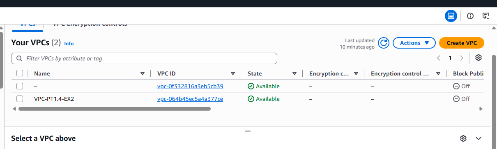
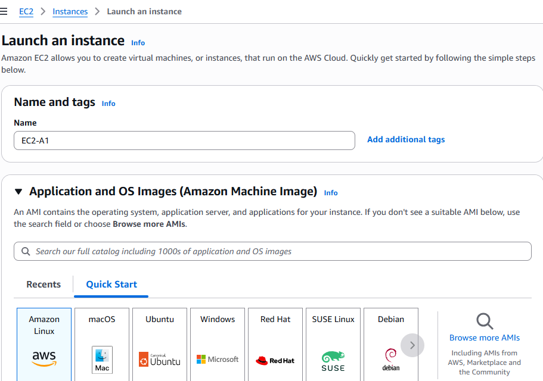
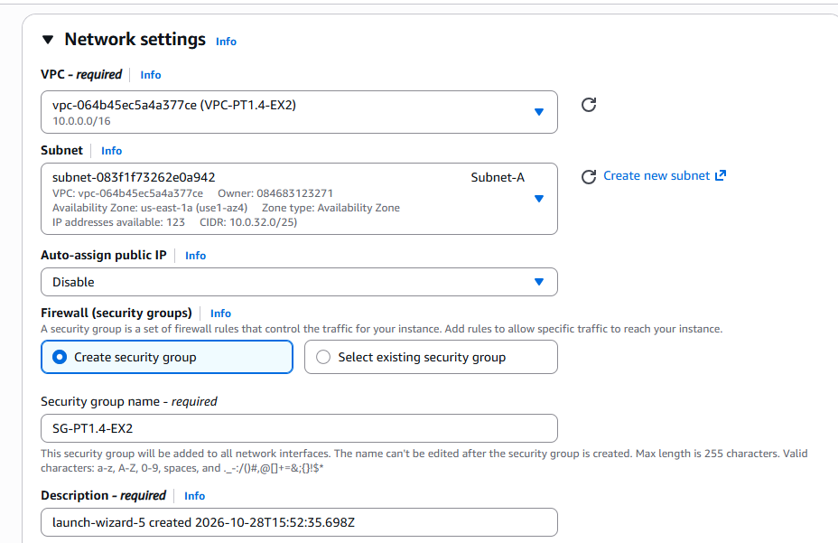
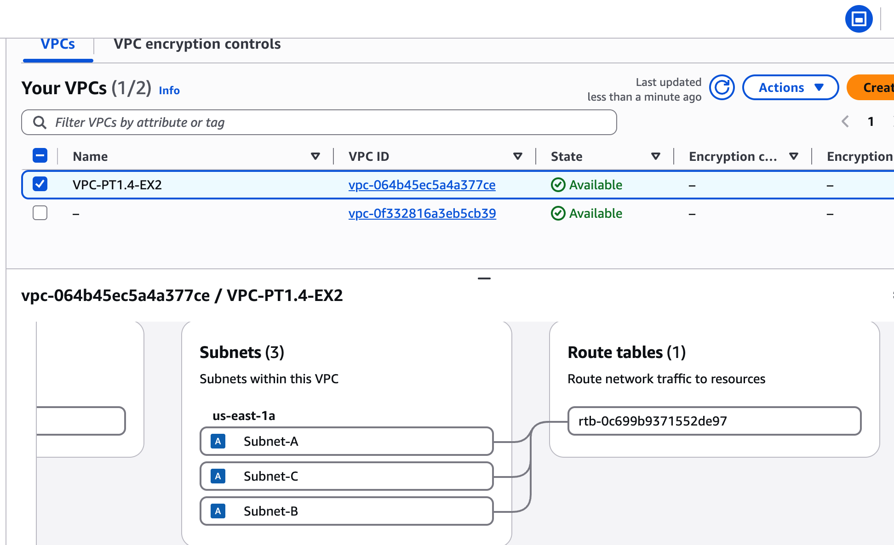

# PT1.4 - Ejercicio 2: Diseño y despliegue de una red en AWS

## Objetivo

Diseñar una red con una VPC, tres subredes y dos instancias EC2 por subred; documentar el despliegue manual desde la consola de AWS y explicar su definición en Terraform mediante el archivo [main.tf](main.tf).

## Parte A: Diseño de red

La configuración de `main.tf` define la VPC `VPC-PT1.4-EX2` con el bloque IPv4 `10.0.0.0/16`, en la región `us-east-1`. Las tres subredes pertenecen a esta VPC y se sitúan en la zona de disponibilidad `us-east-1a`.

| Subred | Bloque IPv4 (CIDR) | Rango de direcciones del bloque | Direcciones utilizables en AWS | Instancias previstas |
| --- | --- | --- | --- | --- |
| Subnet-A | `10.0.32.0/25` | `10.0.32.0` – `10.0.32.127` | 123 | `EC2-A1`, `EC2-A2` |
| Subnet-B | `10.0.30.0/23` | `10.0.30.0` – `10.0.31.255` | 507 | `EC2-B1`, `EC2-B2` |
| Subnet-C | `10.0.33.0/28` | `10.0.33.0` – `10.0.33.15` | 11 | `EC2-C1`, `EC2-C2` |

Los bloques no se solapan y están contenidos en el rango de la VPC. Las direcciones utilizables se calculan restando las cinco direcciones que AWS reserva en cada subred; no representan las direcciones libres después de desplegar las instancias.

Las seis instancias se definen como `t3.micro`, sin asignación de IP pública y con el grupo de seguridad compartido `SG-PT1.4-EX2`. El código no declara una puerta de enlace de Internet, una NAT ni rutas personalizadas; este diseño no acredita conectividad a Internet ni comunicación permitida entre las instancias.

## Parte B: Despliegue manual desde la consola de AWS

### B.1. Creación de la VPC

Creo una VPC llamada `VPC-PT1.4-EX2` desde la consola de AWS y compruebo que aparece en estado `Available`.

### B.2. Configuración de la VPC

Accedo a los detalles de la VPC y compruebo que utiliza el bloque IPv4 `10.0.0.0/16` y que no es la VPC predeterminada.

### B.3. Creación de las subredes

Creo las tres subredes `Subnet-A`, `Subnet-B` y `Subnet-C` dentro de la misma VPC. Compruebo que las tres aparecen en estado `Available`.

### B.4. Comprobación de Subnet-A

Accedo a los detalles de `Subnet-A` y compruebo que tiene la dirección `10.0.32.0/25` y 123 direcciones IPv4 disponibles.

### B.5. Creación de la primera instancia EC2

Entro en EC2, selecciono `Launch an instance`, asigno el nombre `EC2-A1` y selecciono Amazon Linux.

### B.6. Asignación de la instancia a la subred

En `Network settings` selecciono la VPC `VPC-PT1.4-EX2` y la subred `Subnet-A`, situada en la zona `us-east-1a`.

### B.7. Configuración del grupo de seguridad

Desactivo la asignación automática de IP pública y creo el grupo de seguridad `SG-PT1.4-EX2` para las instancias.

### B.8. Comprobación de las seis instancias

Compruebo que las seis instancias `t3.micro` aparecen en estado `Running` en la zona `us-east-1a`. Una instancia adicional está en estado `Terminated` y no forma parte de las seis. Las comprobaciones de estado de EC2-C1 y EC2-C2 todavía se están inicializando.

## Parte C: Despliegue con Terraform (IaC)

### C.1. Configuración de Terraform

Creo el archivo `main.tf` para automatizar la infraestructura que anteriormente realizo de forma manual desde AWS.

En el código configuro los siguientes recursos:

- `aws_vpc`: crea la VPC con la dirección 10.0.0.0/16.
- `aws_subnet`: crea las tres subredes en la zona us-east-1a.
- `aws_security_group`: crea un grupo de seguridad para las instancias.
- `aws_instance`: crea dos instancias EC2 en cada subred utilizando `count = 2`.

### C.2. Despliegue de la infraestructura

Para desplegar la infraestructura utilizo los siguientes comandos:

- `terraform init`: inicializo Terraform.
- `terraform validate`: compruebo que el código sea válido.
- `terraform plan`: reviso los recursos que se van a crear.
- `terraform apply`: creo toda la infraestructura automáticamente.

### C.3. Comprobación del despliegue

Compruebo desde la consola de AWS que se crean correctamente la VPC, las tres subredes y las seis instancias EC2.

### C.4. Topología de red

Realizo un diagrama con draw.io para representar la infraestructura creada.

### B.9. Comprobación de la red

Por último, reviso el mapa de recursos de la VPC y compruebo que las tres subredes están en `us-east-1a` y asociadas a la misma tabla de rutas.

## Parte C: Definición de la infraestructura con Terraform

El archivo [main.tf](main.tf) declara los recursos previstos. Las capturas de la Parte B documentan el despliegue manual; no constituyen evidencia de una ejecución de Terraform.

### C.1. Proveedor y región

El bloque `terraform` requiere el proveedor `hashicorp/aws` con la versión exacta `6.69.1`. El bloque `provider "aws"` selecciona la región `us-east-1`. El archivo no incluye credenciales.

### C.2. VPC y subredes

La variable `vpc_cidr`, de tipo `string`, tiene el valor predeterminado `10.0.0.0/16`. El recurso `aws_vpc.principal` utiliza esa variable y asigna la etiqueta `Name = "VPC-PT1.4-EX2"`.

Los recursos `aws_subnet.subnet_a`, `aws_subnet.subnet_b` y `aws_subnet.subnet_c` referencian `aws_vpc.principal.id`, por lo que pertenecen a la VPC declarada. Cada uno establece su bloque CIDR, la zona `us-east-1a` y su etiqueta de nombre, según la tabla de la Parte A.

### C.3. Grupo de seguridad

El recurso `aws_security_group.ec2` define `SG-PT1.4-EX2` dentro de la VPC. No declara reglas de entrada ni de salida, por lo que el código no permite tráfico mediante este grupo de seguridad. Compartir el grupo no habilita por sí solo la comunicación entre instancias.

### C.4. Instancias EC2

Los recursos `aws_instance.ec2_a`, `aws_instance.ec2_b` y `aws_instance.ec2_c` usan `count = 2`: se definen dos instancias por subred y seis en total. Todos utilizan la AMI `ami-04b938437b69a2c9c` y el tipo `t3.micro`. El identificador de la AMI está fijado en el código; aquí no se verifica su disponibilidad ni su contenido en AWS.

Cada recurso referencia su subred mediante `subnet_id` y el grupo compartido mediante `vpc_security_group_ids`. La opción `associate_public_ip_address = false` desactiva la asignación de una IP pública. La expresión `${count.index + 1}` genera los sufijos `1` y `2` de las etiquetas `EC2-A1`, `EC2-A2`, `EC2-B1`, `EC2-B2`, `EC2-C1` y `EC2-C2`.

### C.5. Alcance de la definición

El archivo no declara tablas de rutas ni asociaciones personalizadas. La tabla compartida que aparece en B.9 corresponde a la captura del despliegue manual.

El código tampoco importa los recursos creados manualmente: ejecutar una aplicación de Terraform sin importarlos al estado intentaría crear los recursos declarados, no adoptar automáticamente los existentes por su nombre.

Esta revisión es documental. No se han ejecutado `terraform init`, `terraform validate`, `terraform plan` ni `terraform apply`, y no se afirma que el despliegue con Terraform haya finalizado correctamente.
