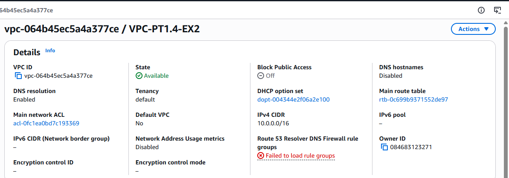
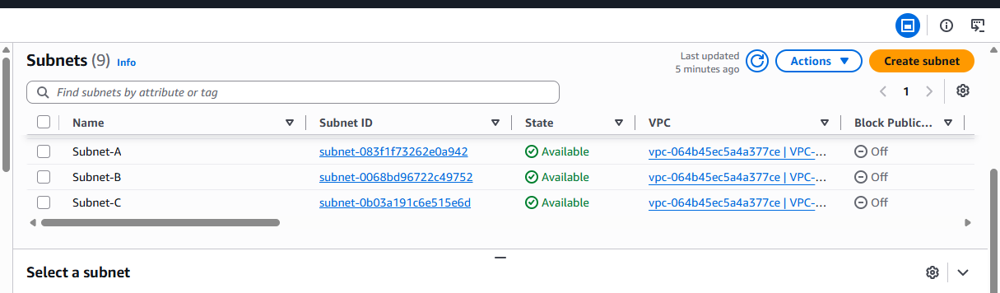
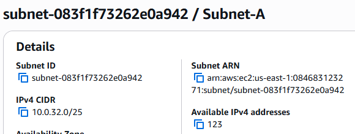
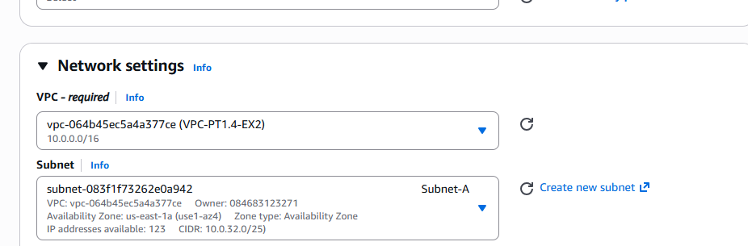
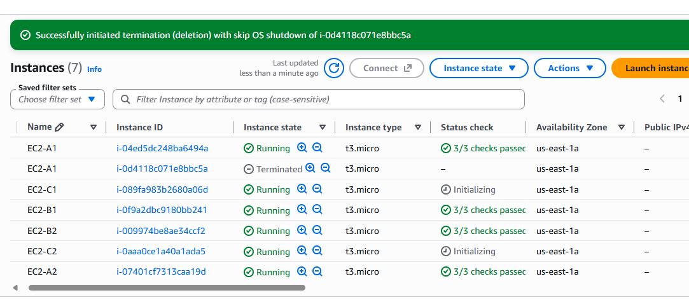

## Parte B: Despliegue manual desde la consola de AWS

### B.1. Creación de la VPC

Creo una VPC llamada `VPC-PT1.4-EX2` desde la consola de AWS y compruebo que aparece en estado `Available`.

### B.2. Configuración de la VPC

Accedo a los detalles de la VPC y compruebo que utiliza el bloque IPv4 `10.0.0.0/16` y que no es la VPC predeterminada.

### B.3. Creación de las subredes

Creo las tres subredes `Subnet-A`, `Subnet-B` y `Subnet-C` dentro de la misma VPC. Compruebo que las tres aparecen en estado `Available`.

### B.4. Comprobación de Subnet-A

Accedo a los detalles de `Subnet-A` y compruebo que tiene la dirección `10.0.32.0/25` y 123 direcciones IPv4 disponibles.

### B.5. Creación de la primera instancia EC2

Entro en EC2, selecciono `Launch an instance`, asigno el nombre `EC2-A1` y selecciono Amazon Linux.

### B.6. Asignación de la instancia a la subred

En `Network settings` selecciono la VPC `VPC-PT1.4-EX2` y la subred `Subnet-A`, situada en la zona `us-east-1a`.

### B.7. Configuración del grupo de seguridad

Desactivo la asignación automática de IP pública y creo el grupo de seguridad `SG-PT1.4-EX2` para las instancias.

### B.8. Comprobación de las seis instancias

Compruebo que las seis instancias `t3.micro` aparecen en estado `Running` en la zona `us-east-1a`. Una instancia adicional está en estado `Terminated` y no forma parte de las seis. Las comprobaciones de estado de EC2-C1 y EC2-C2 todavía se están inicializando.

### B.9. Comprobación de la red

Por último, reviso el mapa de recursos de la VPC y compruebo que las tres subredes están en `us-east-1a` y asociadas a la misma tabla de rutas.

