# Pt2.2 — Infraestructura básica en AWS con Terraform

**Alumno:** Martín Vasquez  
**Grupo:** ASIX2  
**Módulo:** Cloud Computing  
**Fecha:** 19/11/2026  
**Región:** `us-east-1` (N. Virginia)

---

## 1. Objetivo

He desplegado una infraestructura básica en AWS utilizando Terraform.

La infraestructura incluye una VPC, dos subredes públicas, un Internet Gateway, una tabla de rutas, un Security Group y dos instancias EC2.

Todo el código está en este repositorio y se puede reproducir con los comandos de este README.

---

## 2. Resumen de requisitos

| Requisito | Estado | Evidencia |
|---|---|---|
| Proveedor AWS en `us-east-1` | Cumplido | `versions.tf` y captura 14 |
| VPC `VPC-03` con `10.0.0.0/16` | Cumplido | Capturas 01, 02 y 10 |
| Subred pública A `10.0.1.0/24` en `us-east-1a` | Cumplido | Captura 03 |
| Subred pública B `10.0.2.0/24` en `us-east-1b` | Cumplido | Captura 04 |
| Asignación automática de IP pública | Cumplido | Capturas 03 y 04 |
| Internet Gateway asociado a la VPC | Cumplido | Capturas 05 y 11 |
| Ruta `0.0.0.0/0` hacia el IGW | Cumplido | Captura 11 |
| Tabla de rutas asociada a las dos subredes | Cumplido | Captura 11 |
| SSH desde `0.0.0.0/0` | Cumplido | Captura 12 |
| ICMP desde `10.0.0.0/16` | Cumplido | Captura 12 |
| Todo el tráfico saliente permitido | Cumplido | Captura 12 |
| Dos EC2 `t3.micro` con Amazon Linux | Cumplido | Capturas 06, 07 y 13 |
| `ec2-a` en la subred A y `ec2-b` en la subred B | Cumplido | Captura 13 |
| Par de claves `vockey` en ambas instancias | Cumplido | Capturas 08 y 13 |
| Estructura del repositorio y README | Cumplido | Repositorio en GitHub |

---

## 3. Arquitectura desplegada

| Recurso | Nombre | Identificador / valor |
|---|---|---|
| VPC | `VPC-03` | `vpc-0eecc3549c42df62f` — `10.0.0.0/16` |
| Subred pública A | `Public Subnet A` | `subnet-0a822d8fa6c7218fc` — `10.0.1.0/24` — `us-east-1a` |
| Subred pública B | `Public Subnet B` | `subnet-05429f4fdbbfc3faa` — `10.0.2.0/24` — `us-east-1b` |
| Internet Gateway | `IGW-VPC-03` | `igw-04470d983faafaaed` |
| Tabla de rutas | `RT-Public-VPC-03` | `rtb-048164ced8ae06e5e` |
| Security Group | `SG-Pt2.2` | `sg-0120ff0f48ac65ffa` |
| Instancia A | `ec2-a` | `i-05d5969892dcd2037` — `54.226.84.29` |
| Instancia B | `ec2-b` | `i-0860dbe216eb9ce90` — `32.199.245.244` |

Las direcciones IP públicas son temporales. Pueden cambiar si las instancias se detienen y se vuelven a iniciar.

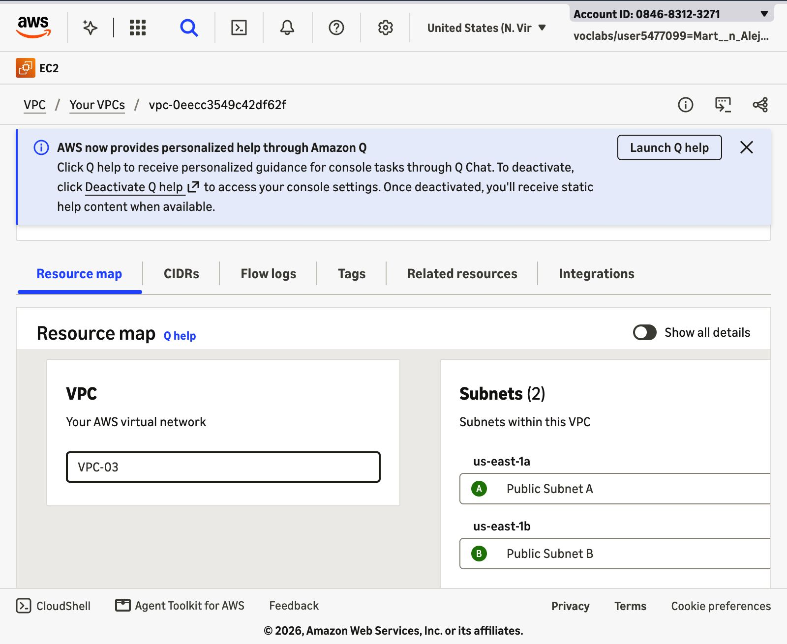

---

## 4. Estructura del repositorio

```text
practiquescloud/
└── pt2-2/
    ├── assets/
    │   ├── 01-vpc-detalle.jpeg
    │   ├── 02-vpc-mapa-recursos.jpeg
    │   ├── 03-subred-publica-a.jpeg
    │   ├── 04-subred-publica-b.jpeg
    │   ├── 05-internet-gateway.jpeg
    │   ├── 06-ec2-a-consola.jpeg
    │   ├── 07-ec2-b-consola.jpeg
    │   ├── 08-ec2-clave-ami.jpeg
    │   ├── 09-security-group-consola.jpeg
    │   ├── 10-terraform-estado.png
    │   ├── 11-aws-tabla-rutas.png
    │   ├── 12-aws-security-group.png
    │   ├── 13-aws-instancia-ec2.png
    │   ├── 14-terraform-validate-plan.png
    │   └── 15-github.png
    ├── main.tf
    ├── variables.tf
    ├── outputs.tf
    ├── versions.tf
    ├── .gitignore
    └── README.md
```

La estructura también se puede comprobar directamente en GitHub.

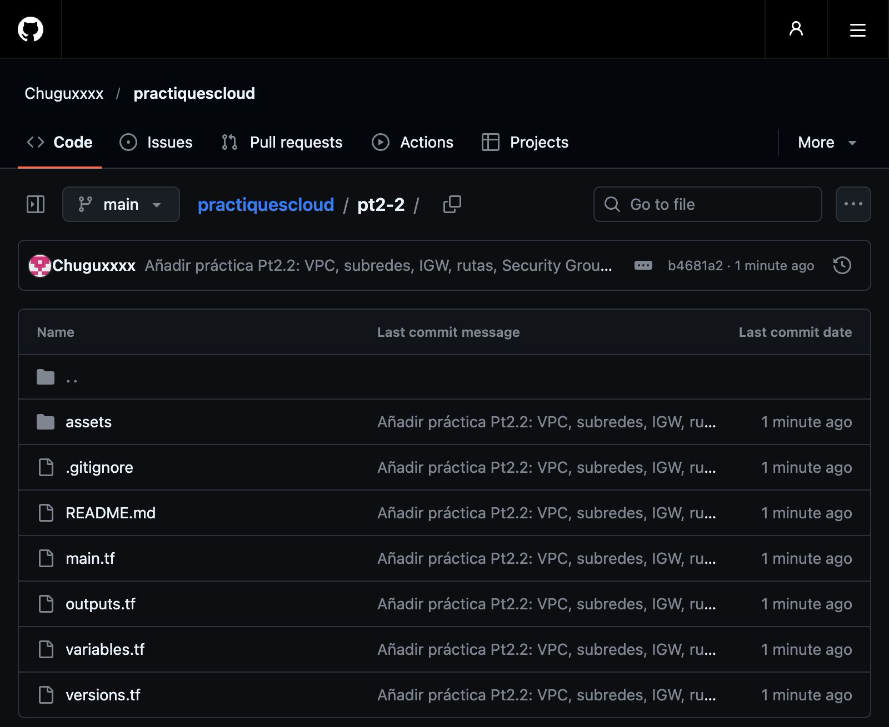

---

## 5. Preparación del entorno

Comprobé las herramientas instaladas en el MacBook.

| Herramienta | Versión |
|---|---|
| Git | 2.54.0 |
| Terraform | 1.17.2 |
| AWS CLI | 2.41.1 |
| GitHub CLI | 2.105.0 |

Terraform, AWS CLI y GitHub CLI no estaban instalados. Los instalé en `~/.local`, sin `sudo` y sin modificar el sistema.

Configuré las credenciales temporales de AWS Academy en `~/.aws/credentials`, con permisos `600`.

Las credenciales no están en el repositorio. Tampoco he subido el archivo `vockey.pem`.

Comprobé la identidad de AWS:

```text
Account: 084683123271
Arn: arn:aws:sts::084683123271:assumed-role/voclabs/user5477099=...
```

También comprobé que el par de claves `vockey` existe en la cuenta y en la región `us-east-1`.

---

## 6. Código Terraform

### `versions.tf`

Define Terraform, el proveedor de AWS y la región.

```hcl
terraform {
  required_version = ">= 1.5.0"

  required_providers {
    aws = {
      source  = "hashicorp/aws"
      version = "~> 6.0"
    }
  }
}

provider "aws" {
  region = var.aws_region
}
```

### `variables.tf`

Centraliza la región, los rangos CIDR, las zonas de disponibilidad, el tipo de instancia y el nombre de la clave.

Los valores por defecto son los que pide la práctica:

- `us-east-1`
- `10.0.0.0/16`
- `10.0.1.0/24` y `10.0.2.0/24`
- `us-east-1a` y `us-east-1b`
- `t3.micro`
- `vockey`

### `main.tf`

Crea la VPC con DNS habilitado.

```hcl
resource "aws_vpc" "vpc_03" {
  cidr_block           = var.vpc_cidr
  enable_dns_support   = true
  enable_dns_hostnames = true

  tags = {
    Name    = "VPC-03"
    Project = var.project_name
  }
}
```

Crea las dos subredes con `map_public_ip_on_launch = true`.

```hcl
resource "aws_subnet" "public_a" {
  vpc_id                  = aws_vpc.vpc_03.id
  cidr_block              = var.public_subnet_a_cidr
  availability_zone       = var.availability_zone_a
  map_public_ip_on_launch = true
  ...
}
```

Crea el Internet Gateway y la tabla de rutas con la ruta por defecto.

```hcl
resource "aws_route_table" "public" {
  vpc_id = aws_vpc.vpc_03.id

  route {
    cidr_block = "0.0.0.0/0"
    gateway_id = aws_internet_gateway.igw.id
  }
  ...
}
```

Asocia la misma tabla de rutas a las dos subredes.

```hcl
resource "aws_route_table_association" "public_a" {
  subnet_id      = aws_subnet.public_a.id
  route_table_id = aws_route_table.public.id
}

resource "aws_route_table_association" "public_b" {
  subnet_id      = aws_subnet.public_b.id
  route_table_id = aws_route_table.public.id
}
```

El Security Group tiene exactamente las tres reglas pedidas.

```hcl
ingress {
  description = "SSH desde cualquier origen"
  from_port   = 22
  to_port     = 22
  protocol    = "tcp"
  cidr_blocks = ["0.0.0.0/0"]
}

ingress {
  description = "ICMP desde la VPC"
  from_port   = -1
  to_port     = -1
  protocol    = "icmp"
  cidr_blocks = [var.vpc_cidr]
}

egress {
  description = "Todo el trafico saliente"
  from_port   = 0
  to_port     = 0
  protocol    = "-1"
  cidr_blocks = ["0.0.0.0/0"]
}
```

La AMI se obtiene dinámicamente. Es la versión más reciente de Amazon Linux 2023 para `x86_64`.

Las dos instancias usan `t3.micro`, la clave `vockey`, el Security Group creado y una subred distinta.

### `outputs.tf`

Muestra los identificadores principales y las IP públicas. También genera los comandos SSH de las dos instancias.

---

## 7. Proceso de despliegue

### 7.1. Formato, inicialización y validación

Ejecuté estos comandos:

```bash
terraform fmt -recursive
terraform init
terraform validate
```

`terraform init` descargó el proveedor `hashicorp/aws` versión `6.73.0` y creó el archivo de bloqueo.

La validación terminó correctamente:

```text
Success! The configuration is valid.
```

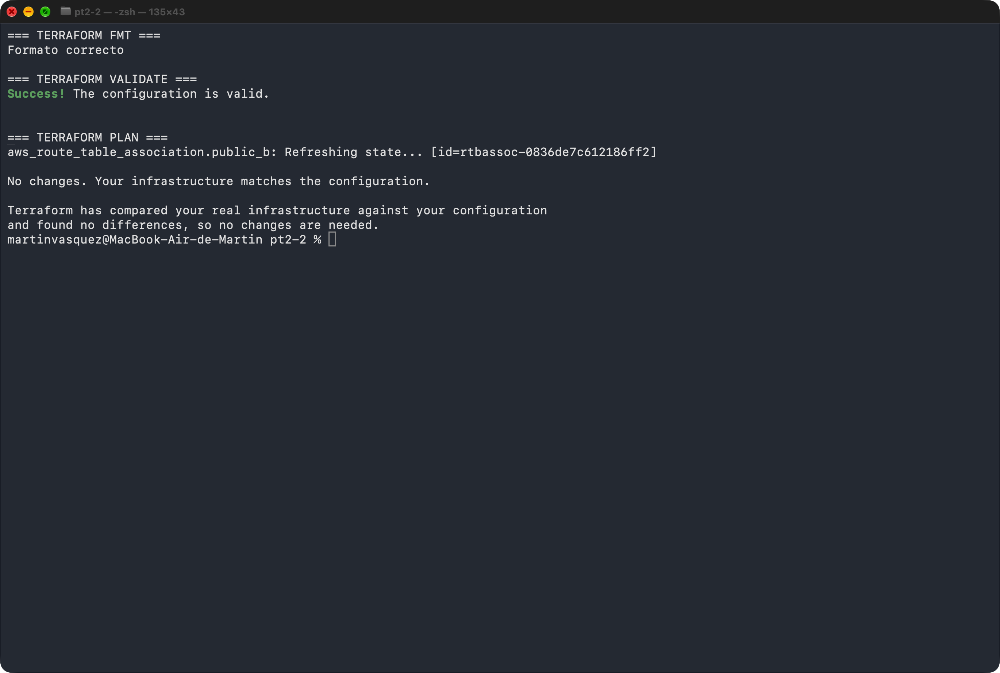

### 7.2. Plan

Ejecuté el plan y guardé el resultado:

```bash
terraform plan -input=false -out=/tmp/pt2-2.tfplan
```

El resumen fue:

```text
Plan: 10 to add, 0 to change, 0 to destroy.
```

Los 10 recursos son: VPC, 2 subredes, IGW, tabla de rutas, 2 asociaciones, Security Group y 2 instancias.

### 7.3. Corrección de errores

El primer `terraform validate` falló con dos errores reales.

1. AWS no permite nombres de Security Group que empiecen por `sg-`.
   - Cambié `sg-pt2-2` por `pt2-2-sg`.

2. AWS no admite tildes en las descripciones del Security Group.
   - Cambié `Todo el tráfico saliente` por `Todo el trafico saliente`.

Después de corregirlo, `terraform validate` y `terraform plan` funcionaron sin errores.

### 7.4. Apply

Con el plan revisado, ejecuté:

```bash
terraform apply /tmp/pt2-2.tfplan
```

Salida real del despliegue:

```text
aws_vpc.vpc_03: Creation complete after 4s [id=vpc-0eecc3549c42df62f]
aws_internet_gateway.igw: Creation complete after 1s [id=igw-04470d983faafaaed]
aws_route_table.public: Creation complete after 1s [id=rtb-048164ced8ae06e5e]
aws_security_group.pt2_2: Creation complete after 4s [id=sg-0120ff0f48ac65ffa]
aws_subnet.public_a: Creation complete after 11s [id=subnet-0a822d8fa6c7218fc]
aws_subnet.public_b: Creation complete after 12s [id=subnet-05429f4fdbbfc3faa]
aws_route_table_association.public_a: Creation complete after 1s
aws_route_table_association.public_b: Creation complete after 0s
aws_instance.ec2_a: Creation complete after 14s [id=i-05d5969892dcd2037]
aws_instance.ec2_b: Creation complete after 14s [id=i-0860dbe216eb9ce90]

Apply complete! Resources: 10 added, 0 changed, 0 destroyed.
```

### 7.5. Verificación del estado

Comprobé el estado con `terraform state list` y `terraform output`.

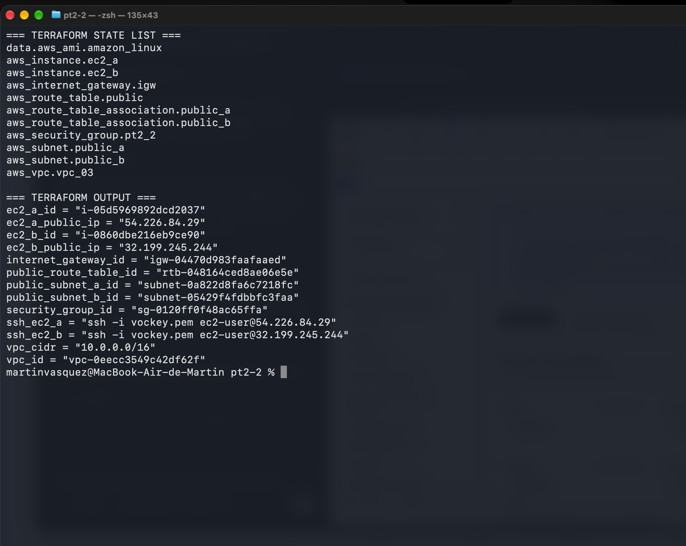

El estado contiene los 10 recursos y los datos de la AMI.

---

## 8. Verificación en AWS

### 8.1. VPC

La VPC se llama `VPC-03`, está disponible y tiene la resolución DNS activada.

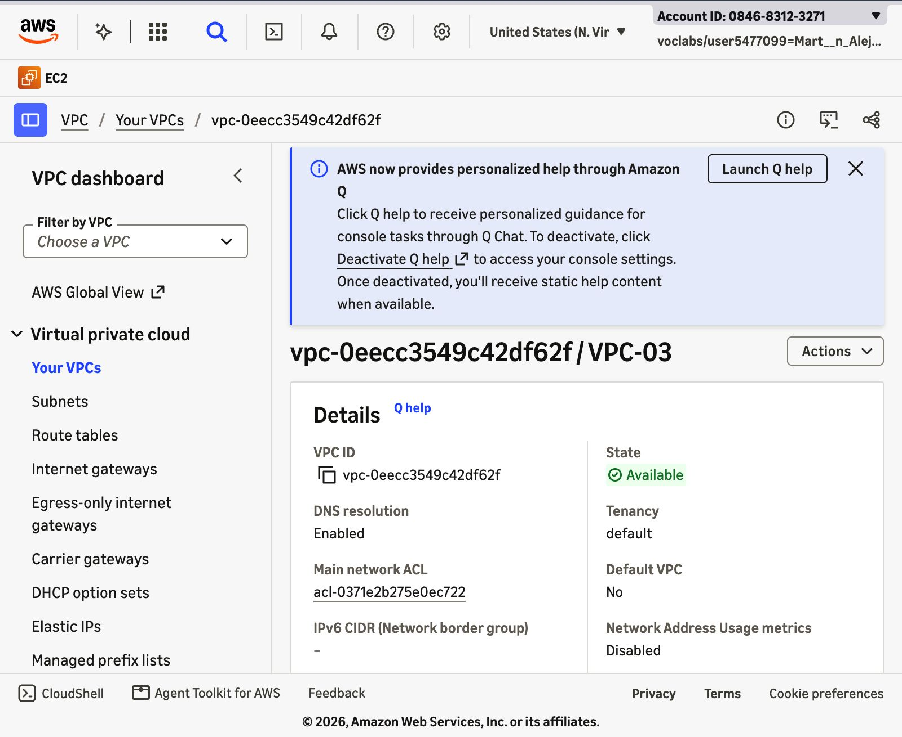

El mapa de recursos muestra la VPC y las dos subredes en zonas distintas.


### 8.2. Subredes públicas

La subred A está en `us-east-1a`, usa `10.0.1.0/24` y tiene `Auto-assign public IPv4 address: Yes`.

También está asociada a la tabla de rutas `RT-Public-VPC-03`.

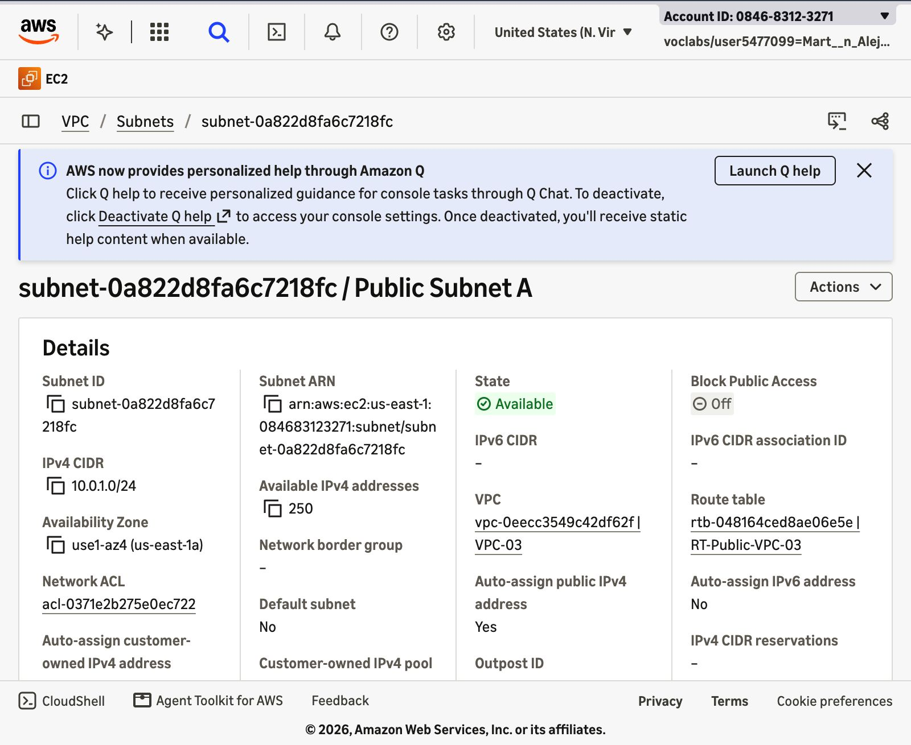

La subred B está en `us-east-1b`, usa `10.0.2.0/24` y también asigna IP pública automáticamente.

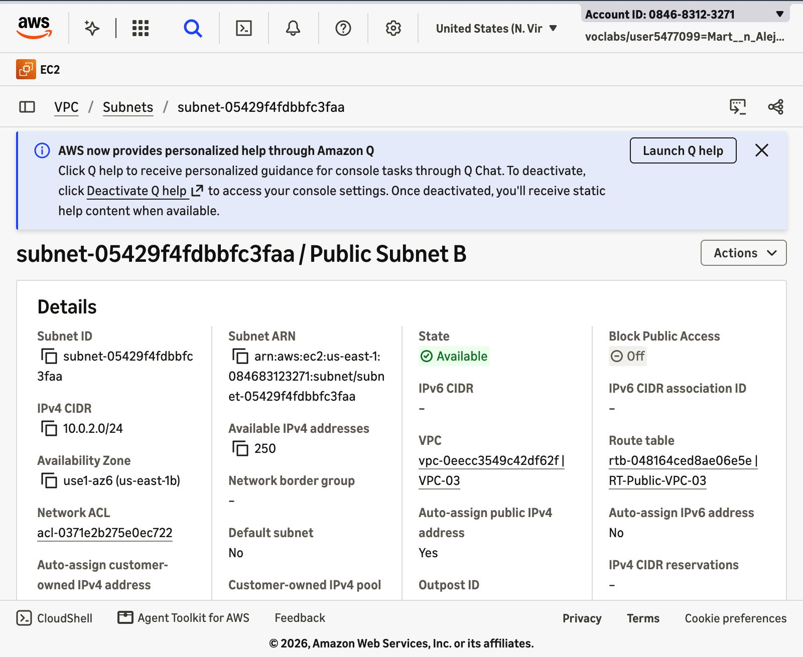

### 8.3. Internet Gateway y rutas

El Internet Gateway `IGW-VPC-03` está creado y en estado `Attached`.

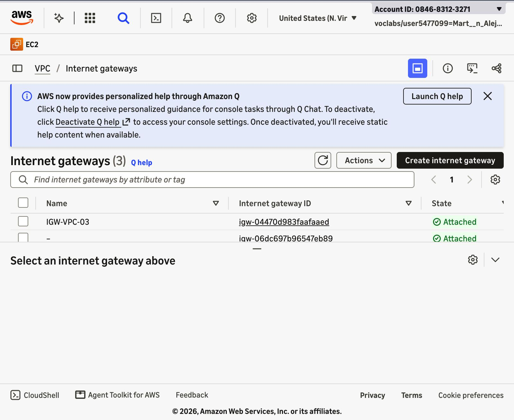

La tabla de rutas tiene la ruta local y la ruta `0.0.0.0/0` hacia `igw-04470d983faafaaed`.

Las dos subredes aparecen asociadas a la misma tabla.

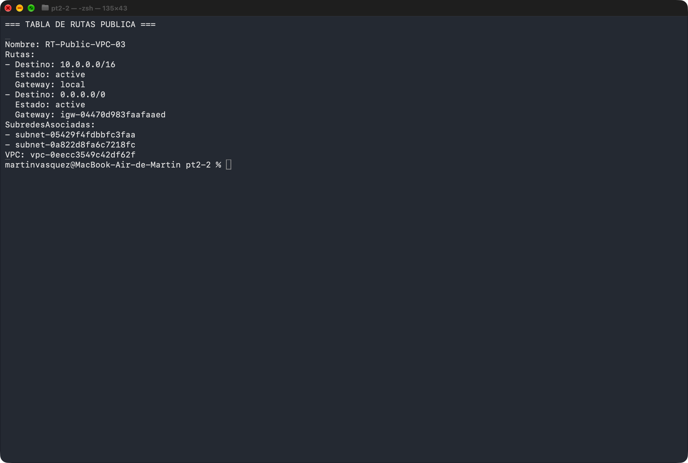

### 8.4. Security Group

El Security Group se llama `pt2-2-sg`.

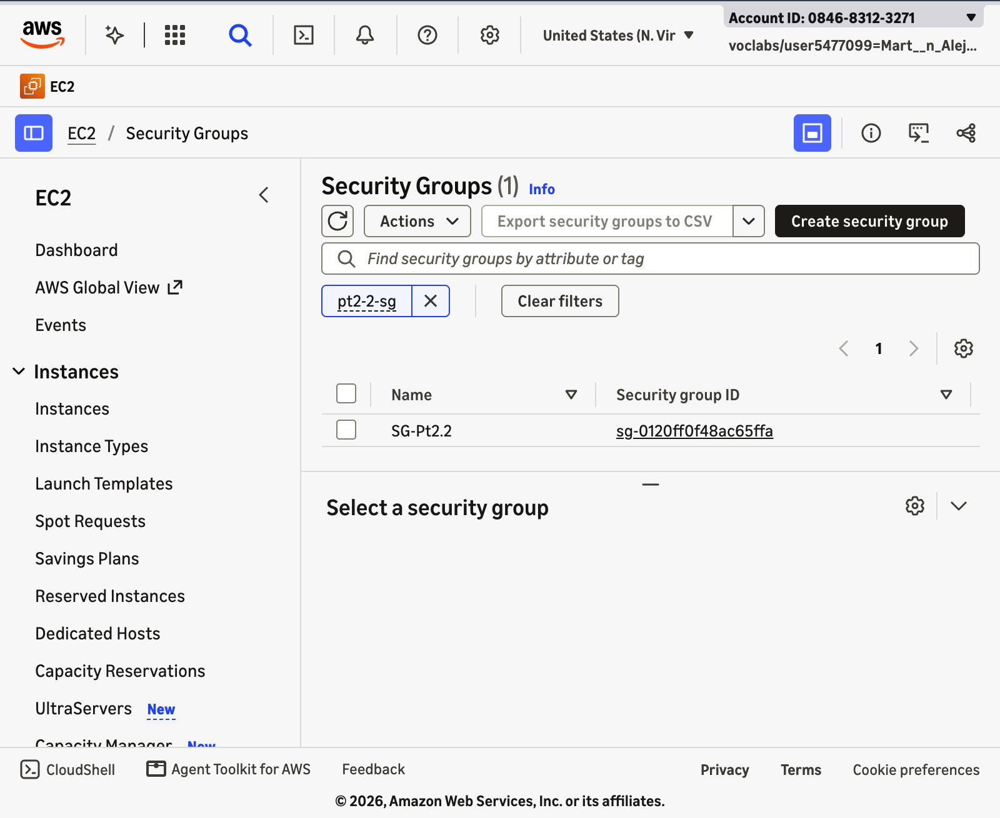

La salida de AWS CLI confirma las tres reglas:

- SSH TCP 22 desde `0.0.0.0/0`.
- ICMP desde `10.0.0.0/16`.
- Todo el tráfico saliente hacia `0.0.0.0/0`.

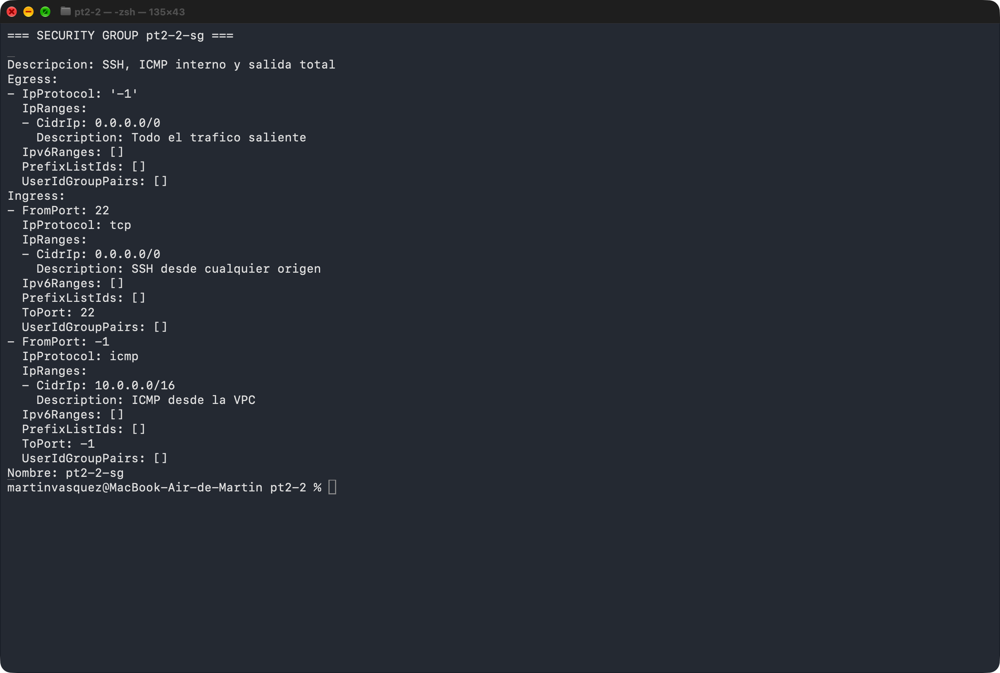

### 8.5. Instancias EC2

`ec2-a` está en ejecución, tiene IP pública `54.226.84.29` y está en `us-east-1a`.

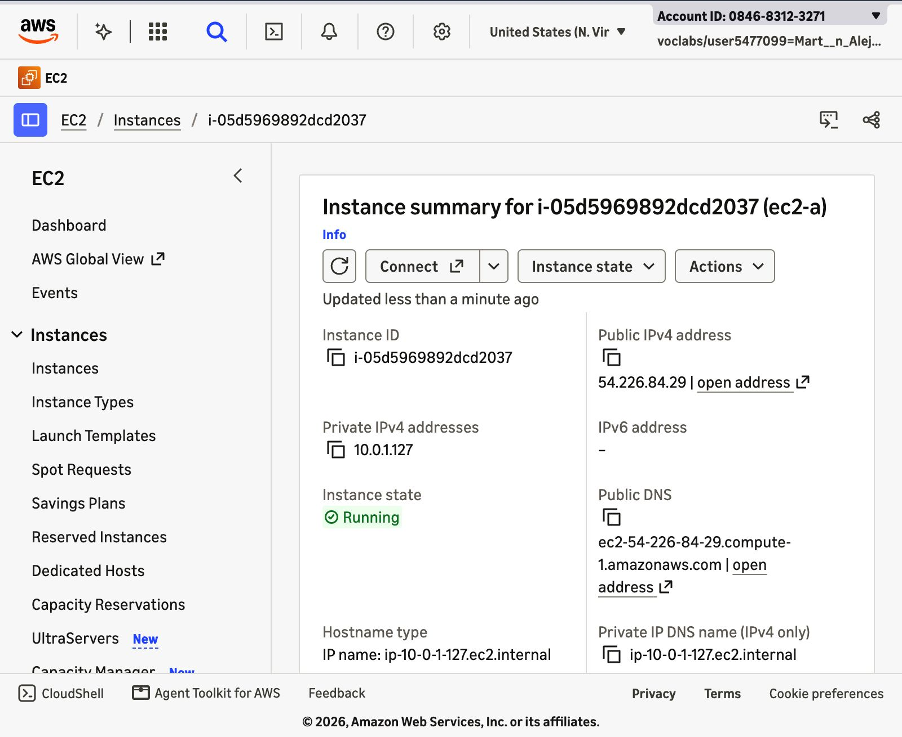

`ec2-b` está en ejecución, tiene IP pública `32.199.245.244` y está en `us-east-1b`.

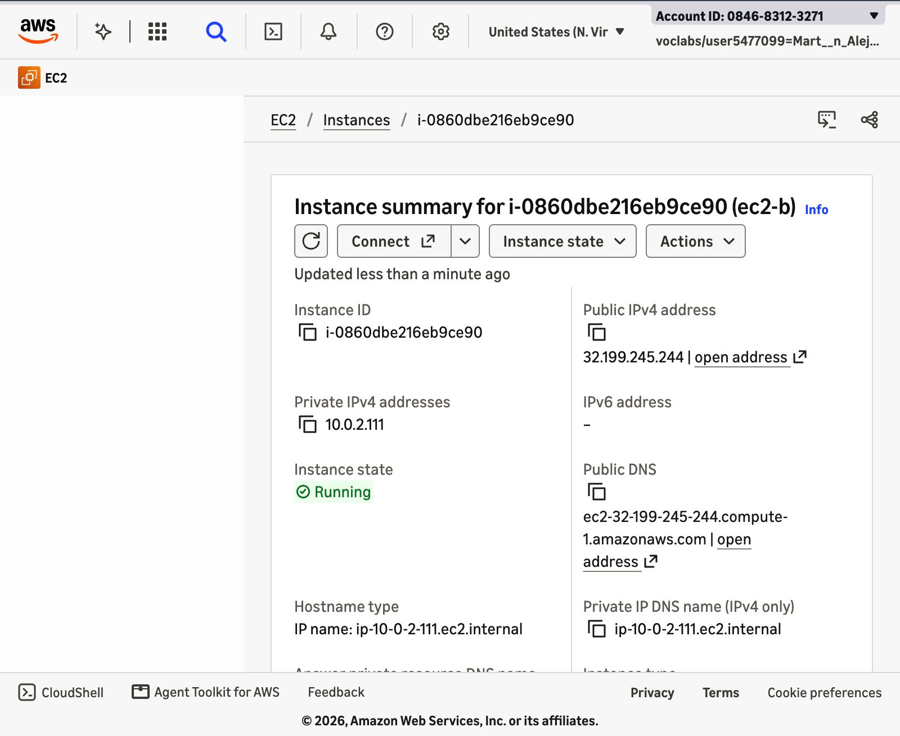

Las dos usan una AMI de Amazon Linux 2023 y el par de claves `vockey`.

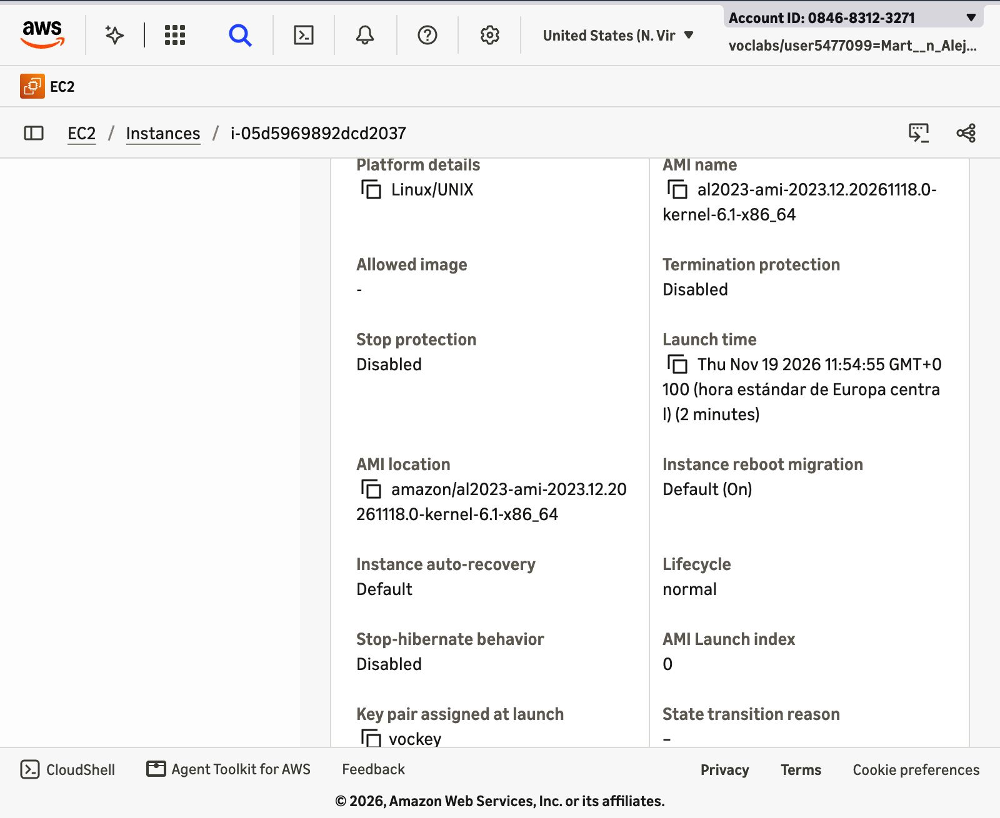

La comprobación con AWS CLI muestra el tipo, la subred, la clave, el Security Group y la IP pública de cada instancia.

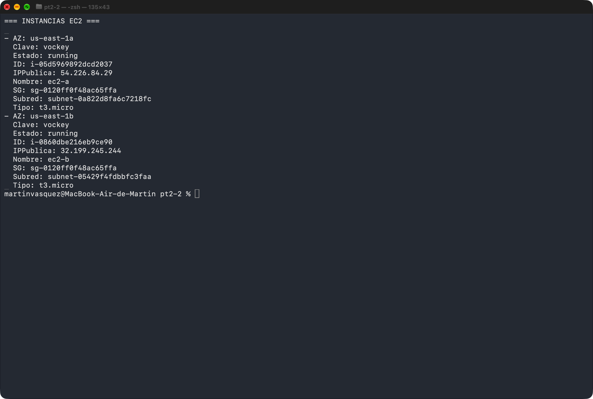

---

## 9. Seguridad e higiene del repositorio

El archivo `.gitignore` excluye:

- `.terraform/`
- `*.tfstate` y `*.tfstate.*`
- `*.tfplan`
- `*.tfvars`
- `*.pem` y `*.ppk`
- `.aws/`

Antes de subir el trabajo comprobé que no había credenciales, claves privadas ni archivos de estado en el índice de Git.

El archivo `terraform.tfstate` se queda en local. Si se pierde, Terraform pierde la referencia de los recursos creados.

Para trabajar en equipo o desde otro equipo, lo correcto sería configurar un backend remoto. En esta práctica he usado estado local porque el enunciado no lo requiere.

---

## 10. Cómo reproducir la práctica

1. Descargar `vockey.pem` desde AWS Academy Learner Lab.
2. Configurar las credenciales temporales de AWS Academy.
3. Entrar en la carpeta `pt2-2`.
4. Ejecutar:

```bash
terraform init
terraform validate
terraform plan -out=pt2-2.tfplan
terraform apply pt2-2.tfplan
terraform output
```

5. Probar la conexión SSH:

```bash
ssh -i vockey.pem ec2-user@54.226.84.29
ssh -i vockey.pem ec2-user@32.199.245.244
```

La IP pública puede ser distinta si las instancias se han reiniciado.

---

## 11. Limpieza de recursos

No he ejecutado `terraform destroy`.

Si hay que eliminar la infraestructura, primero hay que pedir autorización y después ejecutar:

```bash
terraform destroy
```

Este comando elimina la VPC, las subredes, el Internet Gateway, la tabla de rutas, el Security Group y las dos instancias.

---

## 12. Relación con la rúbrica

| Criterio | Peso | Evidencia |
|---|---:|---|
| Provider, VPC y subredes | 20% | `versions.tf`, `main.tf`, capturas 01, 02, 03 y 04 |
| Internet Gateway y tablas de rutas | 15% | Capturas 05 y 11 |
| Security Group | 20% | Capturas 09 y 12 |
| Instancias EC2 y etiquetado | 25% | Capturas 06, 07, 08 y 13 |
| Repositorio y documentación | 20% | Estructura, README y capturas en `assets/` |

---

## 13. Conclusiones

He aprendido a describir una red completa de AWS con Terraform.

Lo más importante ha sido comprobar el plan antes de aplicar los cambios y verificar cada recurso desde la consola y desde AWS CLI.

También he visto que AWS valida los nombres y las descripciones de los Security Groups. Un error pequeño en un texto puede detener todo el despliegue.

El resultado es una infraestructura reproducible, documentada y sin credenciales en el repositorio.

---

**Repositorio:** [github.com/Chuguxxxx/practiquescloud](https://github.com/Chuguxxxx/practiquescloud)
